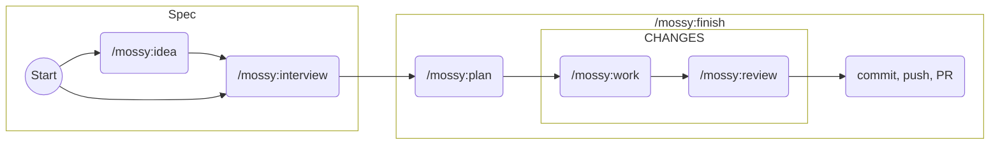

# Mossy Slop

So some techbro bamboozled our bosses to go all in with his framework called flow-next. It gives passable results, admittedly, but burns tokens like there is no tomorrow. Which, you know... 

## Mission Statement

This is supposed to become a leaner alternative, compatible flow-next's state files, and compatible with Mistral.

The focus should be the code; the code is the single source of truth, it should be able to speak for itself. Inline comments should provide the documentation.

The human should retain full control and responsibility. They should be able to verify the quality of individual steps of the process if they want to, or later when everything is done.

It should be the user's choice whether individual steps are committed to git, and whether auto-generated plan metadata gets commited or not.

When questions arise during processing, they should be logged to the human readable output right away, but processing should continue with other parts of the job for as long as reasonably possible; the open questions should then be asked in bulk.

A reasonable effort should be made in the planing phase to discover open questions, but speed and token conservation are valued higher.

## Installation

See [INSTALL.md](INSTALL.md).

## Workflow



### 0. Idea

If you want to start from the very beginning, use `/mossy:idea` to just record your idea in a spec file. The best way is to just call it without parameters and give it the instructions when prompted.

You can also give the idea text directly on the command line, and you can skip straight to step 1. But know that there is a higher risk that your AI will just barge ahead and do the work instead of following the workflow.

### 1. Interview

Refine the idea entered before, or a new idea, with `/mossy:interview`. This will 
check the idea, compare it with the reality of the project, and then ask a couple of questions to make sure the plans will be aligned with your intentions.

#### 2. Planning

`/mossy:plan <spec id>`

This splits the spec into managable work items.

#### 3. Implementation

Execute the tasks using the work skill:

`/mossy:work fn-N.1` or just `/mossy:work --next`

The work skill will:
- Read the task requirements
- Implement the changes
- Record progress

For multiple tasks, execute them in order:

```
/mossy:work fn-N.1
/mossy:work fn-N.2
/mossy:work fn-N.3
```

Or all one after the other without pause with `/mossy:work fn-N`.

#### 4. Review

Before committing/pushing, review all changes:

```
/mossy:review fn-N
```

This will:
- Check that all acceptance criteria are met
- Verify code quality
- Ensure consistency with existing patterns

#### Steps 2 to 4 can be executed in one go using /mossy:finish

#### 5. Commit

When committing manually, commit changes with a clear message:

```bash
git add .
git commit -m "feat: Add mossy-rust skill for Rust language support"
```

Just prompting `commit` usually does the job for you. In .flow/mossy-config, you can
also change the general commit policy so that after every work item, we commit automatically.


## Authorship

This readme file is entirely human written. It serves both as a guide to the AI writing the rest of the system, and information to human users.

The script flowctl.py is taken verbatim from flow-next for maximum compatibility, credit seems to go mostly to Claude Code, with instructions from Gordon Mickel.

The rest of the system is mostly written by Mistral itself, with heavy tweaks by humans.